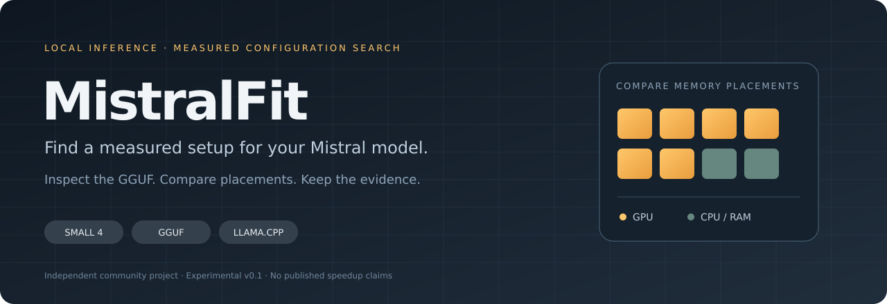

<p align="center"></p>

<p align="center">
  <a href="https://github.com/Berserk-hub150/MistralFit/actions/workflows/test.yml"></a>
  <a href="https://www.python.org/"></a>
  <a href="LICENSE"></a>
  
</p>

<p align="center"><a href="#quick-start">Quick start</a> · <a href="#measure-a-real-model">Run an experiment</a> · <a href="docs/benchmark-method.md">Methodology</a> · <a href="CONTRIBUTING.md">Contribute</a> · <a href="LEGGIMI.md">Italiano</a></p>

**MistralFit measures which local Mistral configuration works best among the candidates tested on your machine.** Inspect a GGUF without loading its weights, compare CPU/GPU and MoE expert placement, then launch the measured winner.

It uses **llama.cpp** for inference and targets **Mistral Small 4**. The search includes upstream automatic fitting, GPU layer offload, CPU-resident experts, mixed expert placement and optional expert caching. Every trial keeps the same context and generation budget.

> **Experimental v0.1.** Parser, planner, process/HTTP integration and reporting have automated tests. Full Small 4 inference and performance still need hardware validation. No speedup is claimed. Independent community project; unaffiliated with Mistral AI.

## What you get

| Capability | Result |
|---|---|
| **GGUF inspection** | Tensor storage, routed-expert sizes, complete shard checks and model identity. |
| **Memory-aware candidates** | Estimated CPU/GPU placements with explicit reasons for exclusions. |
| **Measured comparison** | Streamed TTFT and backend decode timing, including failed trials. |
| **Portable evidence** | Raw JSON and a standalone HTML report with method and limitations. |
| **Winner replay** | A local server launch after checking model and runtime identity. |

Planning is offline and uses Python's standard library. Benchmarking additionally needs a compatible `llama-server` executable and local model weights.

## Why another tool?

llama.cpp already has automatic memory fitting. MistralFit treats that as a **baseline**, then measures a limited search across alternative MoE placements. Every trial retains the same context, prompt hash, token budget, KV data types, and thread count. Failed or unsupported trials remain in the report. A slower result or an upstream-auto winner is a valid outcome.

The useful deliverable is an experiment you can inspect and repeat, together with a command that launches its winner.

## Quick start

Requires Python 3.10+ and Git. Clone the repository and try the planner without a model:

```bash
git clone https://github.com/Berserk-hub150/MistralFit.git
cd MistralFit
python -m mistralfit doctor
python -m mistralfit demo
```

Already downloaded a ZIP? Start inside the directory containing this README. Optional installation: `python -m pip install -e .`; then the `mistralfit` command is available too. This project is not currently published on PyPI.

`demo` prints an **illustrative memory plan with synthetic tensor sizes**. It runs no inference and generates no performance numbers. No network, API key, model download, or package installation is required for these commands.

Windows users can run:

```powershell
powershell -ExecutionPolicy Bypass -File .\scripts\Start-MistralFit.ps1
```

If Python is absent, the script prints the installation command and exits. It does not install software automatically. See [the Italian quick start](LEGGIMI.md).

## Measure a real model

You need a recent, working [llama.cpp](https://github.com/ggml-org/llama.cpp) `llama-server` binary and a locally downloaded GGUF. Start from the upstream [releases](https://github.com/ggml-org/llama.cpp/releases) or [build instructions](https://github.com/ggml-org/llama.cpp/blob/master/docs/build.md), using the backend appropriate to your hardware. Your server build must support the architecture and quantization you downloaded, along with `--fit` and `--n-gpu-layers auto`. Additional candidate features are checked against its help output.

The target model is [Mistral Small 4](https://huggingface.co/mistralai/Mistral-Small-4-119B-2603). Its official model card links GGUF distributions and supported runtimes. Choose a quantization after checking its actual size against your hardware. No model weights or llama.cpp binaries are bundled or automatically downloaded.

```bash
python -m mistralfit doctor --server /path/to/llama-server
python -m mistralfit inspect /models/Mistral-Small-4-Q4.gguf
python -m mistralfit plan /models/Mistral-Small-4-Q4.gguf --ctx 4096
python -m mistralfit tune /models/Mistral-Small-4-Q4.gguf \
  --server /path/to/llama-server --ctx 4096 --tokens 128 --repeats 3
```

Use the first shard for split GGUFs; all shards must be present in the same directory. A model with 119B total parameters remains large even though relatively few experts activate per token. Expert offloading does not eliminate the storage or RAM requirements of those weights.

On Windows:

```powershell
py -3 -m mistralfit tune "D:\Models\model-00001-of-00003.gguf" `
  --server "C:\llama.cpp\llama-server.exe" --ctx 4096 --tokens 128 --repeats 3
```

The output is `results/experiment.json` and an offline `results/experiment.html`. The tool never uploads these. The JSON saves runtime version, model structural fingerprint, settings, candidate definitions, individual timing samples, output hashes, exclusions and selection results. Use `--sha256` to also hash every weight byte for stronger reproducibility; hashing a large model takes time.

## Use the measured winner

```bash
python -m mistralfit serve /models/Mistral-Small-4-Q4.gguf \
  --server /path/to/llama-server --report results/experiment.json
```

The server binds to `127.0.0.1:8000`; its OpenAI-compatible API is at `/v1`. The launcher checks structural model identity and runtime version. If full weight checksums were recorded, they are checked too. These checks do not guarantee that the machine's current memory availability matches the original experiment. `--dry-run` prints exact argv as JSON without starting the server.

```bash
python -m mistralfit check-tools --url http://127.0.0.1:8000
```

This sends a single tool-call request and validates its name and arguments. It executes no tool and is not an agent benchmark or a quality evaluation.

## Search controls

| Option | Meaning |
|---|---|
| `--ctx 8192` | Keep this context for every candidate. A backend-reduced context excludes that candidate. |
| `--ram-gib 56` | Override **available** host/shared RAM, not total installed capacity. |
| `--gpu-gib 10` | Override **available** single-GPU memory. Useful for manual AMD/Intel budgets. |
| `--gpu 0` | llama.cpp main-device index; verify device ordering against `llama-server --list-devices`. |
| `--profiles upstream-auto,cpu-experts` | Restrict the generated search. |
| `--max-ttft 5` | Select only candidates with median time to first token at most five seconds. |
| `--tokens 256 --repeats 5` | Increase output length and measured repetitions. |
| `--prompt-file workload.txt` | Use your workload; the report keeps its hash, not its text. |
| `--allow-paging` | Explicitly try candidates exceeding the estimated host RAM budget; potentially very slow. |
| `--startup-timeout 600 --timeout 180` | Bound model loading and each completion. |

NVIDIA discovery uses `nvidia-smi`; Windows RAM uses the OS API and Linux RAM respects common cgroup v2 limits. Apple Silicon memory is counted once. On macOS, supply `--ram-gib` from a measured available-memory budget; its RAM-pressure behavior is not inferred. Automatic GPU identity mapping across multiple devices/backends is not implemented. Multi-GPU search is outside this release.

## How results are interpreted

- Tensor storage comes from GGUF tensor spans, including alignment padding. KV/scratch memory is an estimate; **peak RSS/VRAM is not measured**.
- The native `/completion` streaming endpoint supplies token counts and decode timings. The client measures time to the first emitted token. Timing fields are never fabricated from character counts.
- One warmup request precedes three measured requests by default. Prompt caching is disabled, and trials reporting reused prompt tokens are excluded.
- Full fixed-length generation ignores EOS for a consistent token budget. It measures a decoding workload, not normal chat completion quality.
- Candidate order is shuffled with seed 42 and recorded. Each profile has one server process; repeated requests are not independent cold-start or thermal runs.
- No language-quality evaluation runs automatically. Output hashes identify differences; a matching hash on one prompt does not establish quality equivalence.
- Throughput is optimized within the tested candidates and optional TTFT limit. This is not an exhaustive global optimum or a promise of improvement over upstream auto.

See [benchmark methodology](docs/benchmark-method.md), [architecture](docs/architecture.md), [FAQ](docs/faq.md), and [reproducible experiment examples](examples/README.md).

## Develop

```bash
python -m unittest discover -v
python -m compileall -q mistralfit
```

No model download is needed for the test suite. The integration fixture emulates the server's HTTP/SSE contract; **it performs no inference**. Do not publish fixture timing values as hardware results. Optional editable installation: `python -m pip install -e .`.

## Contribute evidence

The most useful first contributions are real Mistral Small 4 reports, backend compatibility findings, and fixes accompanied by a reproducible failing case. Use the benchmark issue template and include quantization, full model checksums when possible, upstream commit/build, hardware, context, and workload details. Review report content before sharing it.

No global ranking is published before there is a reliable collection of comparable runs. [The roadmap](ROADMAP.md) lists focused areas where new contributors can help. [The launch plan](docs/launch-plan.md) describes the validation and communication work still needed.

## Next milestones

1. Validate full Small 4 inference on real Windows/Linux NVIDIA hardware and publish raw baseline comparisons.
2. Test expert-cache search across supported upstream versions; improve MLA KV estimates from measured allocations.
3. Add sampled process/GPU memory and explicit device-identity mapping.
4. Add a small, versioned quality/tool-use evaluation and several prompt lengths.
5. Use profiling evidence to choose a specific upstream optimization or native kernel to implement.
6. Evaluate other Mistral models only after weights, architecture and hardware are available.

## Acknowledgements and license

Inspired by the model-focused engineering approach of [antirez's DwarfStar](https://github.com/antirez/ds4). Inference is performed by [llama.cpp/GGML](https://github.com/ggml-org/llama.cpp), which deserves the performance credit. This package does not include code or weights from either project. Mistral models and quantized distributions carry their own licenses.

MistralFit's original code is MIT licensed. The initial package was developed with AI assistance; hardware validation and performance claims require separate evidence. Official model and backend references were checked on 2026-10-15; see [sources](docs/sources.md).
